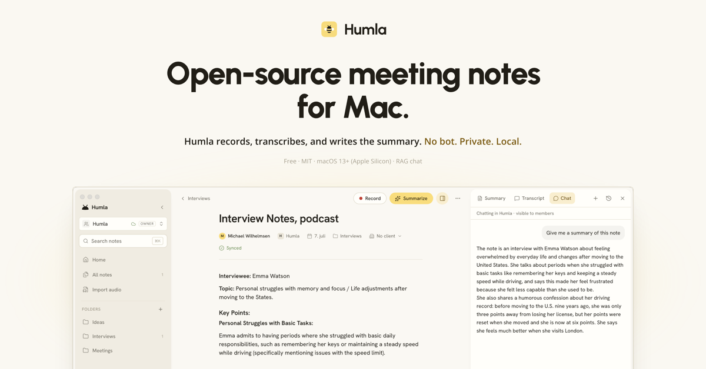

<h1 align="center">HoneyVoice</h1>

<p align="center">
  <a href="https://github.com/NSIETeam/voice-knowledge-os">
    
  </a>
</p>

<p align="center">
  <a href="https://github.com/NSIETeam/voice-knowledge-os"><strong>Source on GitHub</strong></a>
  ·
  <a href="#what-it-does">What it does</a>
  ·
  <a href="#privacy">Privacy</a>
  ·
  <a href="#how-it-works">How it works</a>
  ·
  <a href="#build-from-source">Build</a>
</p>

<p align="center">
  <a href="https://github.com/NSIETeam/voice-knowledge-os"></a>
  <a href="#license"></a>
  
  
</p>

<h1></h1>

## About

**HoneyVoice** is a local-first meeting and voice-knowledge app for macOS, built on the open-source [Humla](https://github.com/michaelwilhelmsen/humla) project. Take freeform notes while HoneyVoice records your microphone and system audio, transcribes the conversation, separates speakers, and creates a structured summary grounded in what was said.

Built around one principle: **your audio and your data stay on your machine** unless you explicitly send them somewhere you choose — a transcription/LLM provider, or an optional sync server. Everything works locally — recording, transcription, speaker identification, even summarisation if you point it at a local LLM.

> [!NOTE]
> Personal notes work locally without an account. Audio and notes stay on this Mac unless you choose a cloud model provider or connect a sync server. Local transcription and summarization options are available. This repository contains the desktop client; it does not currently publish an official installer or promise a managed sync service.

## What it does

### Records your meetings, two streams at once

HoneyVoice captures your microphone and your computer's audio (Zoom, Meet, Slack huddles, anything) at the same time, kept as two separate streams. That means in a remote call your voice doesn't get mixed with the other person's, so the transcript stays clean and "you said vs. they said" is unambiguous. In an in-person meeting it records your room mic and tags the different voices it hears.

### Transcribes accurately — including in your language

Pick the transcription engine that fits, and you can mix-and-match **per language**:

- **Local Whisper** — runs entirely on your Mac via Apple Silicon's GPU. Free after a one-time download. Multiple multilingual models plus a **Norwegian-tuned model** (NB Whisper Large from Nasjonalbiblioteket).
- **Apple Speech** — optional on-device transcription on macOS 26 and later. It returns Apple's source-audio time ranges into the shared transcript timeline for audio-linked review; macOS manages the language assets and audio is not sent to a transcription service. Local Whisper remains available on older supported macOS versions.
- **OpenAI** — `whisper-1`, `gpt-4o-transcribe`, `gpt-4o-mini-transcribe`, `gpt-4o-transcribe-diarize`.
- **Deepgram** — Nova-3 / Nova-2, native diarization, very strong on conversational English.
- **Groq** — `whisper-large-v3-turbo` at OpenAI-compatible endpoints — same Whisper quality, ~10× cheaper and faster than OpenAI's hosted Whisper.

Set a **default provider** in Settings, then add **per-language overrides** if you want — e.g. *Norwegian → Local NB Whisper, English → Deepgram, fallback → OpenAI*. HoneyVoice picks the right one automatically based on the recording's language.

### Identifies speakers, automatically and offline

When you stop the recording, HoneyVoice runs a speaker-identification pass on your Mac (no audio uploaded). It labels each turn with `Speaker 1`, `Speaker 2`, etc. — click any label to rename them ("Speaker 2" → "Wilma") and the change applies across the whole transcript.

Two engines, both free and on-device:
- **Community-1** — robust default, auto-detects how many speakers are in the room.
- **Sortformer** — better at rapid back-and-forth, fixed 4-speaker cap.

### Summarises with both your notes and the transcript

When you click *Summarize*, the model gets your typed notes **and** the transcript as two separate labelled inputs — `[Notater]` and `[Transkripsjon]`, tagged *user-written* and *auto* so it knows which is which. Pick a preset — Meeting / 1:1 / Lecture / Interview / Brainstorm / Voice memo — or write your own.

The summary can run on:
- **Cloud providers** — OpenAI, DeepSeek, MiMo (including compatible Coding Plan endpoints), and Anthropic.
- **Any OpenAI-compatible local server** — Ollama, LM Studio, llama.cpp, vLLM. Sensitive meetings can stay 100% on-device.

### Ask your notes — and see where the answer came from

Every note has a **Chat** tab that answers questions about your meetings. It isn't a canned prompt over one transcript: the assistant runs a real retrieval loop, **searching and reading your notes** to ground its answer, then **cites the notes it used** as chips you can click straight through to.

- **Hybrid retrieval** — full-text keyword search *and* semantic (embedding) search over your notes, so it finds things you didn't phrase exactly right.
- **Choose how wide it looks** — this note, this folder, or all your notes, per conversation.
- **See its work** — it shows what it searched and read, so an answer is auditable rather than a black box.
- **Local or cloud** — use Ollama on-device, or choose OpenAI, DeepSeek, MiMo, or Anthropic. Chat is configured separately from transcription and summary providers.

### Use your notes from Claude Code, Codex, or any MCP client

HoneyVoice ships its own **[Model Context Protocol](https://modelcontextprotocol.io) server**, so the agent you already work in can search and read your meeting notes without you switching apps. Ask Claude Code *"what did we agree with Acme about the renewal?"* and it looks it up in your actual meetings.

Six read-only tools: `search_notes`, `get_note`, `get_transcript`, `list_notes`, `list_folders`, `list_clients`. Search spans your typed notes, the summary **and** the spoken transcript, and each result says which of the three it came from — so "what did they actually say" is a question you can ask. Results can be narrowed by folder, client, who spoke, language, and a date window (relative — *the last 30 days* — or absolute, *2026-06-01 to 2026-06-30*).

- **Off until you turn it on.** Settings → General → Integrations, which then hands you a ready-to-paste config line for Claude Code and for Codex. Installing an update never quietly opens your meetings to anything.
- **Read-only, and no audio.** Nothing an agent does can change or delete a note, and no tool returns or references a recording — the same absolute rule the rest of the app follows.
- **No key, no network, no server.** It's a small local binary that reads your SQLite database directly, so search is keyword-based rather than embedding-based: nothing to pay for, nothing to send anywhere, and no Keychain prompt. There's no port and no token — the file permissions on your own machine are the authorization.
- **Works whether or not HoneyVoice is open**, and always reads the workspace you're currently in. The workspace is resolved on HoneyVoice's side, never passed in, so a client can't ask its way from Personal notes into a shared workspace or back.

### Stays out of your way

- **Custom vocabulary** — names, jargon, acronyms biased into the transcription so they spell consistently.
- **Per-note language** — each note can override the global language for one-off bilingual calls.
- **Folders + search** — flat folder list with full-text search across titles, bodies, transcripts, and folder names.
- **Click-to-edit transcript** — coloured speaker pills inline; click anywhere to fix a transcription error.
- **Obsidian round-trip** — export session-aware Markdown with speaker labels and stable block IDs. In builds registered for the `honeyvoice://` link, clicking a transcript timestamp returns to that note, recording session, and time in HoneyVoice. The audio stays in HoneyVoice's local recording store; it is never copied into the Vault, and timestamps are plain text when that take has no local playback file.
- **Source-audio ledger** — every take records local SHA-256 fingerprints and byte counts for the original mic/system streams. You can verify retained audio from the recording-session strip; a changed file is reported with its expected and current hash. The ledger contains no audio and is not uploaded.
- **Release check** — Check for Updates checks this repository. Until a public release is published, there is no installer available through the app.
- **System-aware light/dark theme** — clean, typographic UI in Hanken Grotesk with a warm gold accent.

## Privacy

The defaults are designed so nothing you write leaves your machine unless you tell it to.

- **No backend by default.** Your notes, transcripts and audio never leave this Mac unless you turn on sync. Outbound traffic is limited to the API endpoints you've configured, GitHub when you manually check for a release, and — *if* you opt into sync — the server you configure.
- **Anonymous counters, and you can switch them off.** To find out whether people actually get the app working, HoneyVoice counts a few milestones: first launch, and whether onboarding was finished or skipped. Each is sent at most once per install and carries nothing else — no identifier, no account, no version, nothing about what you configured or recorded. They're stored as plain daily tallies, so there's nothing to tie back to you even in principle. The setup wizard says so on every step and lets you turn it off there; afterwards it lives in Settings → General → **Send anonymous usage counters**. If you installed HoneyVoice before this existed, you're not counted unless you switch it on yourself.
- **Your notes and transcripts** live in a single SQLite database at `~/Library/Application Support/com.miraphant.voice-memory/`.
- **Recorded audio is not kept unless you ask for it.**
  - While recording, audio lives in a per-recording temp directory, deleted once transcription and the speaker pass are finished.
  - By default **nothing survives that** — no playback file, no raw streams. The note keeps its transcript and word timings, so it still renders in full; you just don't get a player.
  - A compact `source-audio.json` provenance ledger remains in the local recording folder. It contains source hashes, sizes, session ID and capture time, but no speech or audio; it is not part of the sync asset list.
  - Turn on Settings → Recording → **Keep recorded audio** to store meetings under `~/Library/Application Support/com.miraphant.voice-memory/recordings/<note_id>/`: a mixed `playback.wav` for playing the meeting back with word-by-word highlight, plus the raw per-source mic and system WAVs, useful for re-running speaker detection. Roughly 1 MB per minute per channel.
  - The setting describes **this Mac**, not just its own recordings — with it off, a teammate's synced audio isn't downloaded here either.
  - Turning it off is going-forward only. **Delete stored audio…**, in the same settings section, sweeps what's already on disk and keeps every transcript and timeline.
- **The MCP server is off until you enable it**, and read-only when you do. It's a local binary reading the same SQLite database — no port, no network, and no tool that can reach a recording. Turning it off in Settings takes effect on the next tool call, not at the client's next restart.
- **API keys** are stored in the macOS **Keychain**, not in plaintext on disk.
- **Model downloads** are one-time fetches from HuggingFace; the files live in `~/Library/Application Support/com.miraphant.voice-memory/models/` and `~/Library/Application Support/FluidAudio/Models/`.

If you use only Local Whisper + Community-1 (or Sortformer) + a local LLM for summaries, **no audio or text ever leaves your Mac**.

## Optional sync

Personal notes work offline. The client also contains a PocketBase-based sync implementation for accounts and shared workspaces. A compatible sync server must be configured separately; this repository does not currently offer a managed sync service. See [`src-tauri/crates/cloud-sync`](src-tauri/crates/cloud-sync) for the client protocol and implementation.

## Quick start

There is not yet an official, signed macOS installer in this repository's [Releases](https://github.com/NSIETeam/voice-knowledge-os/releases). Build from source below to try HoneyVoice. Local ad-hoc builds are for development only: they are not notarized, and macOS privacy permissions may not survive a rebuild. A public installer requires a stable Developer ID signature and notarization.

Permission status and requests are handled by the bundled `audio-capture` helper, the same process that opens the microphone and ScreenCaptureKit for recording. After changing a permission in System Settings, restart HoneyVoice before testing capture. Local ad-hoc builds are not suitable for public distribution; a stable Developer ID signature and notarization are still required for a public installer.

Keep a single installed copy of HoneyVoice. After replacing an ad-hoc local build,
macOS may retain an enabled privacy switch whose grant names an older build.
If recording access stays denied, remove only the HoneyVoice entry in the
relevant privacy panel and re-add the exact app shown under Settings → Recording
→ Running from, then relaunch. Do not reset permissions for unrelated apps.

See the [macOS release acceptance checklist](docs/RELEASE_ACCEPTANCE.md) for
the verified local status and the evidence required before shipping an
installer. A successful build alone does not pass the audio-capture gate.
After building and opening the app:

1. **Choose providers** in Settings. Local Whisper and a local LLM keep processing on this Mac; cloud providers such as DeepSeek, MiMo, OpenAI, and Anthropic receive the content you send them. API keys are saved in the macOS Keychain.
2. *Optional*: download a speaker-diarization model under Settings → Transcription → Speaker diarization.

That's it. Click *Record* to start, *Stop* when you're done, *Summarize* when you want notes.

The in-app release check is configured for this repository. Until a release is published, installable updates are not available there.

## How it works

```
┌─────────────────────────────────────────────────────────────┐
│ React + Vite frontend                                       │
│  Tiptap editor · Zustand store · Tailwind v4                │
└──────────────────────┬──────────────────────────────────────┘
                       │ Tauri IPC
┌──────────────────────▼──────────────────────────────────────┐
│ Rust backend                                                │
│                                                             │
│  ┌─────────────┐  ┌─────────────────┐  ┌─────────────────┐  │
│  │SQLite       │  │ audio-capture   │  │ speaker-diarize │  │
│  │ notes /     │  │ sidecar (Swift) │  │ sidecar (Swift) │  │
│  │ folders /   │  │ AVAudioEngine + │  │ FluidAudio      │  │
│  │ settings    │  │ ScreenCaptureKit│  │ (CoreML / ANE)  │  │
│  └─────────────┘  └─────────────────┘  └─────────────────┘  │
│                                                             │
│  ┌─────────────────────────────────┐  ┌─────────────────┐   │
│  │ HTTPS clients                   │  │ Local Whisper   │   │
│  │ OpenAI / DeepSeek / MiMo / HF   │  │ whisper-rs/Metal│   │
│  └─────────────────────────────────┘  └─────────────────┘   │
└─────────────────────────────────────────────────────────────┘
```

In plain language: when you hit Record, a small native Swift helper captures your microphone and your system audio as two separate streams, splits each one into short clips at natural speech pauses, and feeds the clips to whichever transcription engine you picked. Your typed notes are saved continuously alongside the transcript. When you stop, HoneyVoice runs speaker identification offline (still no audio leaves your Mac) and labels the transcript. *Summarize* sends your notes + the transcript to your chosen LLM and produces a structured Markdown summary. Notes are also indexed for search — full-text plus embeddings — which is what the Chat tab draws on when it goes looking for an answer. The MCP server reads that same database — the keyword half of the index, so it needs no API key — which is why an outside agent searches the notes you already have rather than a copy of them.

For a deep dive into the architecture — module map, data flow, gotchas — see [`CLAUDE.md`](CLAUDE.md).

## Build from source

### 本地模型镜像下载

当前源码中的 Whisper 下载器支持「自动（优先镜像）」「官方」和「仅使用镜像」，
每次安装均校验固定文件大小与 SHA-256，校验通过后才显示完成。
自动模式对 Medium Q5 / Large v2 Q5 / Large v3 Q5 优先使用 ModelScope；
其余模型使用 HF Mirror 和官方来源，不会偷偷改用另一款模型。
镜像不保证任何网络环境下均可访问；失败后可切换来源并重试，现有模型不会被半成品覆盖。
此改动尚未打包安装；已安装的 0.1.2 仍使用旧下载界面。

已安装版本遇到 Hugging Face 下载不可用时，可运行
`bash scripts/install-local-model-mirror.sh`。它通过 ModelScope 安装已验证的
Medium Q5 多语言模型（约 539 MB），保留 TLS 校验并核对固定 SHA-256；
已有文件校验不一致时不会覆盖。然后在「设置 → 转录 → Model」选择
「Medium (quantized)」。`--check` 只核验已安装的文件，不下载。
脚本不会更换应用签名或影响既有录音权限。


Requires macOS 14+, Apple Silicon recommended. The bundled speaker-diarization
runtime requires macOS 14; Apple SpeechTranscriber is an optional on-device
provider on macOS 26 and later, with Local Whisper available on supported older
systems.

Prerequisites:
- Rust toolchain (`curl --proto '=https' --tlsv1.2 -sSf https://sh.rustup.rs | sh`)
- Node 20+ and `pnpm`
- Xcode command line tools (`xcode-select --install`)
- `cmake` (for `whisper.cpp`)

```bash
git clone https://github.com/NSIETeam/voice-knowledge-os.git
cd voice-knowledge-os
pnpm install
./scripts/build-sidecar.sh    # builds the audio-capture Swift sidecar
./scripts/build-diarize.sh    # builds the speaker-diarize Swift sidecar
./scripts/build-mcp.sh        # builds the humla-mcp server binary
pnpm tauri dev
```

All three are bundled binaries the app declares up front, so the build fails if any is missing — run them once after cloning, and again only when you change their source.

To build a launchable `.app` bundle locally:

```bash
pnpm tauri build --debug
open src-tauri/target/debug/bundle/macos/HoneyVoice.app
```

To create a public macOS release, `scripts/release.sh` requires a valid Developer ID Application certificate and Apple notarization credentials in `.env.notarise`. Releases are distributed as manually installed DMGs; automatic in-app installation is not enabled.

## Project layout

```
voice-knowledge-os/
├── src/                        # React frontend (Tiptap + Zustand)
├── src-tauri/                  # Rust backend (Tauri 2)
│   ├── src/
│   │   ├── commands.rs         # recording lifecycle, chunk transcription, diarize-on-stop
│   │   ├── commands/           # command groups: notes, folders, settings, chat, clients,
│   │   │                       #   cloud, export, models, summary, api_keys, …
│   │   ├── recording.rs        # session state, per-source trails
│   │   ├── stt/                # STT adapter abstraction (OpenAI/Local/Deepgram/Groq)
│   │   ├── chat/               # agentic note-chat: tool loop, retrieval, providers
│   │   ├── mcp/                # the MCP server's six read-only tools over your notes
│   │   ├── bin/humla-mcp.rs    # that server as a second binary, shipped in the bundle
│   │   ├── diarize.rs          # speaker-diarize sidecar wrapper
│   │   ├── local_whisper.rs    # whisper-rs + Metal model registry
│   │   └── openai.rs           # OpenAI HTTP client + summary endpoint
│   └── binaries/               # signed sidecar binaries
├── audio-capture/              # Swift sidecar: mic + screen audio
└── speaker-diarize/            # Swift sidecar: offline diarization
```

## Tech stack

- **Frontend** — React 19 + Vite 6 + Tailwind v4 + Tiptap + Zustand + react-markdown + lucide-react
- **App shell** — Tauri 2, Rust 1.85, reqwest (rustls-tls), rusqlite (bundled), tokio
- **Local Whisper** — `whisper-rs` 0.16 (binds `whisper.cpp`) with the `metal` feature; `large-v3-turbo-q5` default plus alternative multilingual models and NB Whisper Large for Norwegian
- **Speaker diarization** — FluidAudio Swift package; pyannote community-1 + VBx clustering with PLDA, *or* NVIDIA Sortformer; CoreML on Apple Neural Engine
- **Note chat** — agentic tool loop over retrieval tools; hybrid search combining SQLite **FTS5** keyword ranking with semantic embedding similarity; OpenAI-compatible providers, Anthropic, or Ollama
- **MCP server** — `rmcp` (the official Rust MCP SDK) over stdio, built as a second binary from the same crate and signed into the app bundle; opens the notes database directly, so it runs with or without the app
- **Audio capture** — Swift, `AVAudioEngine`, `ScreenCaptureKit`; permission status and requests use the bundled capture helper. Ad-hoc local signatures can still be treated as a different macOS permission identity; see the [release acceptance checklist](docs/RELEASE_ACCEPTANCE.md).

## Acknowledgements

HoneyVoice is built on the open-source [Humla project](https://github.com/michaelwilhelmsen/humla) and stands on the shoulders of:

- [whisper.cpp](https://github.com/ggml-org/whisper.cpp) by Georgi Gerganov — the local transcription engine
- [FluidAudio](https://github.com/FluidInference/FluidAudio) — the offline diarization pipeline (pyannote community-1 + VBx + PLDA, plus Sortformer, ported to CoreML)
- [NB Whisper Large](https://huggingface.co/NbAiLab/nb-whisper-large) by Nasjonalbiblioteket — Norwegian-tuned Whisper model
- [Tauri](https://tauri.app) — the native app shell
- [Tiptap](https://tiptap.dev) — the rich-text editor
- [Granola](https://granola.ai) — the user-experience inspiration

## License

MIT.
